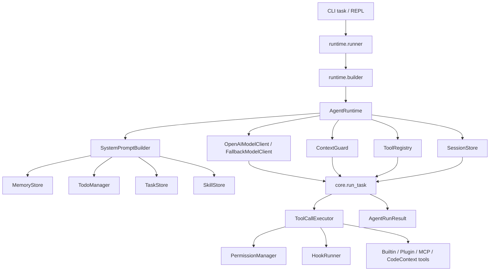

# zx-code

[English](README.en.md) · [可复现演示](docs/DEMO.md) · [贡献指南](CONTRIBUTING.md) · [MIT License](LICENSE)

`zx-code` 是一个用 Python 实现的本地 Coding Agent 运行时。当前项目以 CLI
体验为核心，重点覆盖 Agent 主循环、工具执行、会话状态、代码库检索、子代理、
插件、MCP 工具和可追踪的本地运行。

## 项目定位与状态

面向需要查看工具执行过程、持久化会话和扩展自定义工具的开发者。
当前是早期 alpha：提供可复现的离线运行时演示，尚未建立公开用户规模或性能基准。
权限规则用于控制工具调用，不构成操作系统级沙箱；文件编辑返回 diff，尚无通用一键撤销。

## 功能特性

- ReAct 风格的 Agent 主循环，支持 OpenAI-compatible Chat Completions 模型。
- 工具注册表和按需发现的 `tool_search`。
- 内置文件工具：读取、写入、编辑、grep、glob 和 shell 执行。
- CodeContext 代码索引与混合检索：embedding、加权关键词、代码感知分词、
  path/symbol 排序和 snapshot 元数据。
- 支持 `--resume` 的会话持久化。
- Memory、todo、任务 DAG 和 skill 状态存储。
- 子代理能力，可选 worktree 隔离。
- 插件命令工具和 MCP server 工具。
- 权限管理、hooks、circuit breaker、输出截断、debug log 和结构化 trace。

## 环境要求

- Python `3.11+`，macOS 或 Linux（会话文件锁依赖 POSIX `fcntl`，暂不支持原生 Windows）
- [`uv`](https://docs.astral.sh/uv/)
- 用于模型调用的 OpenAI-compatible API key

## 快速开始

从源码安装（无需 PyPI）：

```bash
git clone https://github.com/dahuangggg/zx-code.git
cd zx-code
```

安装依赖：

```bash
uv sync --locked --extra dev
```

配置默认模型 profile 使用的 API key：

```bash
export OPENAI_API_KEY="your-openai-key"
```

执行一次任务：

```bash
uv run zx-code "总结这个仓库"
```

进入 REPL：

```bash
uv run zx-code
```

运行测试：

```bash
uv run pytest -q
```

`agent` 命令保留为兼容别名，Python 导入路径仍为 `agent`。
也可以在独立环境中用 `pip install .` 安装；构建产物可通过 `uv build` 生成。
项目尚未在本文中声明已发布到 PyPI。

无需 API Key 体验真实工具、权限拦截和会话恢复：

```bash
uv run python examples/offline_demo.py --output .zx-code/artifacts/offline-demo
```

演示使用固定模型响应，不会调用模型 API。[演示说明与真实模型录屏脚本](docs/DEMO.md)。

## 常用命令

```bash
# 单次运行指定模型
uv run zx-code --model openai/gpt-5.4-mini "分析 src/agent/core/loop.py"

# 关闭流式输出
uv run zx-code --no-stream "列出主要 runtime 模块"

# 限制 Agent 轮数
uv run zx-code --max-turns 8 "找到工具执行链路"

# 恢复指定 session
uv run zx-code --resume demo-session "继续"

# 打印生成后的 system prompt
uv run zx-code --print-system-prompt

# 写入 JSONL debug log
uv run zx-code --debug-log --debug-log-path .zx-code/logs/debug.jsonl "调试这次运行"

# 写入结构化 trace 和 HTML trace
uv run zx-code --trace --trace-html "追踪一个短任务"
```

## 配置

配置按以下顺序加载：

1. 用户配置：`~/.zx-code/config.toml`
2. 项目配置：`.zx-code/config.toml`
3. CLI 参数覆盖

可以从示例配置开始：

```bash
cp .zx-code/config.toml.example .zx-code/config.toml
```

主要配置段：

- `[agent.model]`：默认模型、fallback 模型、流式输出、超时和 reasoning effort。
- `[[agent.model.profiles]]`：命名模型 profile 和 API key 环境变量。
- `[agent.context]`：上下文预算、保留最近消息数量和 compact 模型。
- `[agent.state]`：session、memory、skills、todos 和 task 存储路径。
- `[agent.permissions]`：默认工具权限和可选规则文件。
- `[agent.subagents]`：子代理开关和最大嵌套深度。
- `[agent.worktree]`：可选的子代理 worktree 隔离。
- `[agent.code_context]`：本地代码搜索索引和 embedding 配置。
- `[agent.debug]` / `[agent.trace]`：诊断输出。
- `[agent.extensions]`：hooks、插件目录和 MCP server。

模型 profile 示例：

```toml
[[agent.model.profiles]]
name = "primary"
model = "openai/gpt-5.4-mini"
api_key_env = "OPENAI_API_KEY"
```

OpenAI-compatible Chat Completions endpoint 可以通过 `extra_kwargs` 传递客户端参数：

```toml
[[agent.model.profiles]]
name = "custom"
model = "openai/gpt-5.4-mini"
api_key_env = "CUSTOM_API_KEY"
extra_kwargs = { base_url = "https://example.com/v1" }
```

## CodeContext 代码搜索

CodeContext 提供本地代码库索引和 `code_search`。它组合了：

- 显式 embedding function，不依赖 Chroma 默认 embedding；
- 持久化 Chroma 向量库；
- 持久化 sparse keyword index；
- 支持 `camelCase`、`PascalCase`、`snake_case` 和路径的代码感知分词；
- 对 content、relative path、文件 stem、language 和 symbol 加权索引；
- Python module preamble chunk，用于保留 imports、module docstring 和顶层初始化；
- weighted RRF 和轻量 rerank，用于 path/symbol/exact 命中；
- 默认过滤 lockfile、generated file、构建产物和本地缓存。

启用方式：

```toml
[agent.code_context]
enabled = true
path = ".zx-code/cache/code-context/chroma"
snapshot_dir = ".zx-code/cache/code-context/snapshots"
collection = "agent_code_context"
embedding_model = "text-embedding-3-small"
embedding_api_key_env = "OPENAI_API_KEY"
embedding_base_url = ""
top_k = 5
max_result_chars = 4000
max_total_chars = 12000
```

索引 snapshot 会记录 embedding function 名称。如果 embedding 模型配置发生变化，
indexer 会把旧 snapshot 视为过期并重建索引，避免混用不兼容的向量空间。

典型使用流程：

1. 对目标仓库运行 `code_index`。
2. 使用 `code_search` 做架构级或自然语言检索。
3. 用 `read_file`、`grep` 或 `glob` 继续精确查看。

## 内置工具

默认初始可见工具保持很小：

- `tool_search`
- `bash`
- `read_file`
- `write_file`
- `edit_file`
- `grep`
- `glob`

其他工具可通过 `tool_search` 按需激活，包括：

- todo 和 task 工具；
- memory 工具；
- skill 加载；
- team / subagent 工具；
- worktree 工具；
- CodeContext 工具；
- plugin 工具；
- MCP 工具。

工具执行统一经过 `ToolCallExecutor`，它在 registry 执行前后处理 hooks、权限、
circuit breaker、输出截断、metrics 和 trace logging。

## 运行时架构



关键模块：

- `src/agent/main.py`：Typer CLI 入口。
- `src/agent/runtime/runner.py`：单次运行和 REPL 编排。
- `src/agent/runtime/builder.py`：组合根，装配配置、模型、工具、状态、prompt、trace、MCP 和插件。
- `src/agent/runtime/types.py`：类型化 runtime bundle。
- `src/agent/core/loop.py`：Agent 主循环。
- `src/agent/core/tool_executor.py`：模型 tool call 执行。
- `src/agent/core/context.py`：上下文预算和 compaction。
- `src/agent/core/recovery.py`：模型超时、限流、上下文溢出和 fallback 恢复。
- `src/agent/core/concurrency.py`：子代理使用的轻量协作调度器。
- `src/agent/model_types/`：消息、工具协议、运行结果和指标模型。
- `src/agent/tools/`：内置工具和工具注册表。
- `src/agent/code_context/`：索引、snapshot、sparse search、vector store 和 rerank。
- `src/agent/state/`：memory、skills、sessions、todos 和 tasks。
- `src/agent/trace/`：JSONL 和 HTML trace。

## Session 和状态

默认本地状态位于 `.zx-code/state`：

- sessions：`.zx-code/state/sessions`
- memory：`.zx-code/state/memory/MEMORY.md`
- todos：由 `TodoManager` 管理
- tasks：`.zx-code/state/tasks`
- skills：`skills`

Session id 规则：

```text
new run: cli:<timestamp>:<random>
resume:  --resume 或 --session-id 传入的 id
```

## 权限和 Hooks

权限通过 `[agent.permissions]` 配置。默认 decision 是 `allow`，也可以为单个工具覆盖：

```toml
[agent.permissions]
default = "allow"
rules_path = ".zx-code/permissions.toml"

[agent.permissions.tools]
bash = "ask"
edit_file = "allow"
```

Hooks 通过 `[agent.extensions].hooks_path` 配置。Hooks 会围绕工具执行运行，可以在
registry 执行前拒绝或观察工具调用。

## 插件和 MCP

插件目录在 `[agent.extensions]` 中配置：

```toml
[agent.extensions]
plugin_dirs = [".zx-code/plugins"]
```

MCP server 也可以在同一段配置：

```toml
[[agent.extensions.mcp_servers]]
name = "filesystem"
command = "python"
args = ["./mcp_servers/filesystem_server.py"]
env = { TOKEN = "env-or-placeholder-only" }
```

插件和 MCP 工具会注册进同一个 `ToolRegistry`，并和内置工具一样经过权限、hooks、
circuit breaker、输出截断和 trace。

## 开发

运行完整测试：

```bash
uv run pytest -q
```

运行定向测试：

```bash
uv run pytest tests/test_code_context_indexer.py -q
uv run pytest tests/test_runtime.py -q
uv run pytest tests/test_tools.py -q
```

查看 CLI：

```bash
uv run zx-code --help
```

常用诊断输出：

```bash
uv run zx-code --debug-log --debug-log-path .zx-code/logs/debug.jsonl "短任务"
uv run zx-code --trace --trace-html "短任务"
```

## 反馈与许可

欢迎通过 [试用反馈](https://github.com/dahuangggg/zx-code/issues/new/choose) 分享真实任务与结果，
或按 [贡献指南](CONTRIBUTING.md) 提交修复。请勿提交凭据、私有代码或未经检查的 trace。
项目采用 [MIT License](LICENSE)。版本变化见 [CHANGELOG](CHANGELOG.md)，发布步骤见
[RELEASING](docs/RELEASING.md)。
