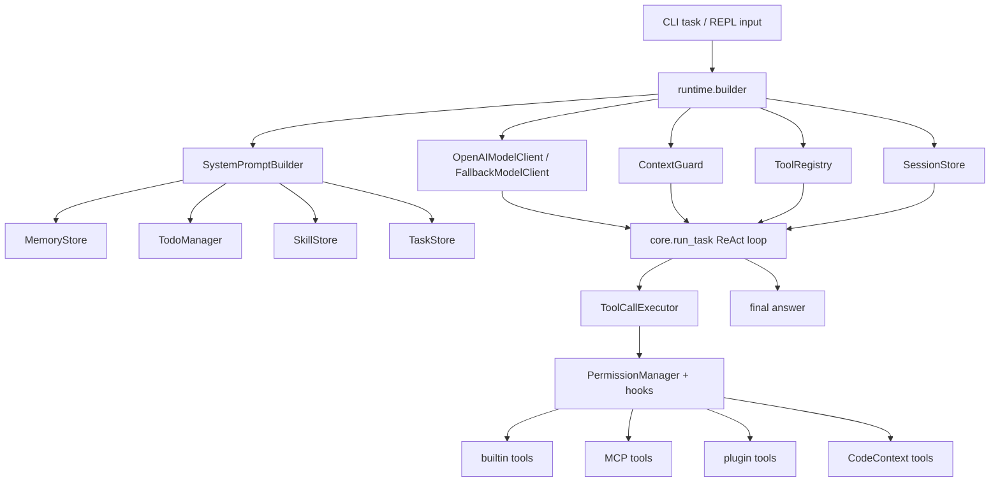

# zx-code

`zx-code` 是一个用 Python 实现的本地 Coding Agent 运行时实验仓库。当前分支刻意收缩为 CLI-only runtime：先把核心 Agent loop、工具系统、状态持久化、上下文恢复和子代理执行打稳，再重新设计多通道、投递和主动调度能力。

## 快速开始

环境要求：

- Python `3.11+`
- [`uv`](https://docs.astral.sh/uv/)

安装依赖：

```bash
uv sync --dev
```

配置模型 key：

```bash
export OPENAI_API_KEY="your-openai-key"
```

一次性执行：

```bash
uv run agent "总结这个仓库的核心架构"
```

进入 REPL：

```bash
uv run agent
```

常用参数：

```bash
uv run agent --model gpt-5.4 "读取 README"
uv run agent --no-stream "列出当前项目结构"
uv run agent --max-turns 8 "分析 src/agent/core/loop.py"
uv run agent --resume demo-session "继续上次任务"
uv run agent --print-system-prompt
uv run agent --debug-log --debug-log-path .zx-code/logs/debug.jsonl "调试一次运行"
uv run agent --trace --trace-html "记录一次结构化 trace"
```

运行测试：

```bash
uv run pytest -q
```

## 当前架构

```text
CLI
  -> runtime runner
  -> typed runtime builder
  -> core ReAct loop
  -> OpenAI model client
  -> ToolRegistry
  -> SessionStore
```



## 核心模块

- `src/agent/main.py`：Typer CLI 参数入口。
- `src/agent/runtime/runner.py`：单次任务和 REPL 两种 CLI 运行模式。
- `src/agent/runtime/builder.py`：组合根，装配模型、工具、状态、prompt、trace、MCP 和插件。
- `src/agent/runtime/types.py`：typed `AgentRuntime`、状态 bundle 和服务 bundle。
- `src/agent/core/loop.py`：ReAct 主循环。
- `src/agent/core/tool_executor.py`：执行模型请求的 tool calls。
- `src/agent/core/context.py`：上下文预算、裁剪和 compact。
- `src/agent/core/recovery.py`：模型调用超时、限流、溢出和 fallback 恢复。
- `src/agent/core/concurrency.py`：CLI 子代理使用的最小协作式调度器。
- `src/agent/model_types/`：消息、工具协议、运行时结果和指标模型；`agent.models` 保持兼容 re-export。
- `src/agent/tools/`：内置工具、工具注册表和 tool pack 分组；默认注入 `tool_search` 与 `Read/Write/Edit/Grep/Glob` 基础文件工具。
- `src/agent/state/`：memory、todo、task DAG、skills、session 持久化。
- `src/agent/trace/`：结构化 trace 和可选 HTML 输出。
- `src/agent/code_context/`：代码索引与检索，`CodeContextIndexer` 作为门面，内部拆分 snapshot、job、pipeline、search service。

## 已移除范围

这个分支移除了旧的多通道运行时：

- `channels/`
- `scheduling/`
- Telegram 长轮询适配器
- Gateway / BindingTable / DMScope session key
- DeliveryQueue / DeliveryRunner / DeliveryDaemon
- Heartbeat / Cron
- `--channel`、`--watch`、`--telegram-*`、`--heartbeat-*`、`--cron-*` CLI 参数和配置

CLI session 规则也简化为：

```text
new run: cli:<timestamp>:<random>
resume:  用户传入的 session_id 原样使用
```

后续重新添加多通道时，应以当前 CLI-only runtime 为核心重新设计入口，而不是恢复旧的 gateway 结构。
