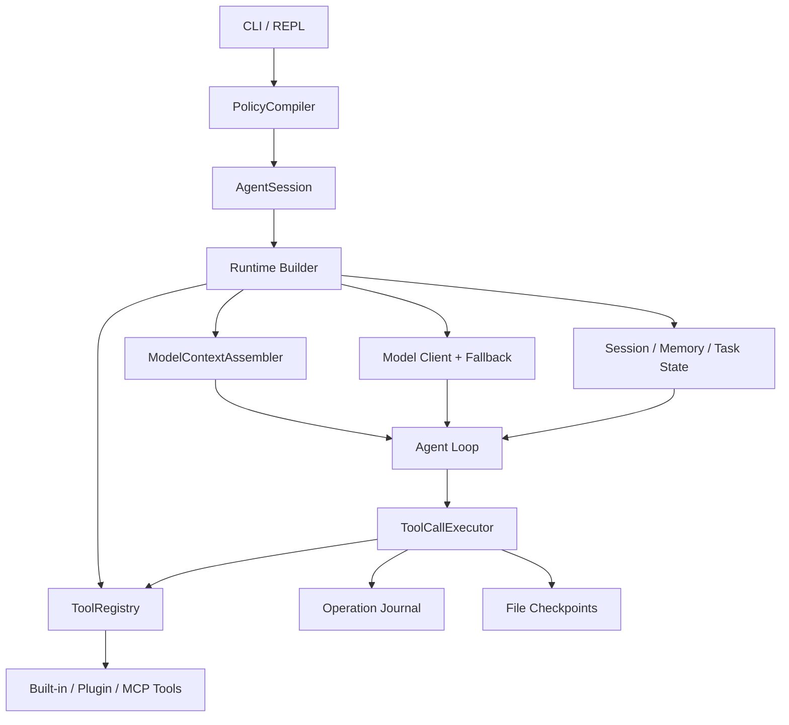

# zx-code

[](https://github.com/dahuangggg/zx-code/actions/workflows/ci.yml)


一个用 Python 构建的本地 Coding Agent 运行时，重点解决三个问题：Agent 能做什么、
副作用发生了什么，以及出错后如何安全恢复。

`zx-code` 不只是把模型接到 shell。它把 workspace trust、capability policy、工具权限、
operation journal、文件 checkpoint、长生命周期 session 和上下文预算放进同一条执行链，
并保留 MCP、Plugin、Skill、Subagent 与 Team 的扩展能力。

> [!IMPORTANT]
> `zx-code` 目前是面向学习和实验的原型。它提供应用层 policy 与审计能力，但不是
> 操作系统级 sandbox；运行不可信任务时仍应使用容器、虚拟机或独立账号做隔离。

## 为什么做这个项目

多数 Coding Agent 原型很快就能完成“模型调用工具”的 happy path，真正困难的是边界：

- 项目配置能否偷偷扩大权限或替换模型端点？
- 工具超时或进程崩溃后，副作用到底成功、失败，还是未知？
- Agent 修改文件后，能否在不覆盖用户后续编辑的前提下撤销？
- REPL 的多轮任务是否共享同一个 runtime、session 和恢复状态？
- system prompt、工具 schema、历史消息和输出空间是否都计入上下文预算？

`zx-code` 把这些问题作为运行时的一等概念，而不是散落在各个工具里的特殊判断。

## 核心能力

- **Safe Run policy**：保留 user / project / CLI 配置来源，项目配置只能收紧权限，
  不能授予 trust、扩大 roots/capabilities 或替换受保护的模型设置。
- **可审计工具执行**：每次工具调用都有 operation ID，并以 `committed`、`failed` 或
  `unknown` 状态写入 append-only journal。
- **安全撤销文件修改**：write/edit 成功后生成 checkpoint、diff 和内容 hash；只有
  当前文件仍匹配 postimage 时才允许 undo。
- **长生命周期 Session**：REPL 在一个 `AgentSession` 内执行多次 run，统一管理模型、
  MCP、Plugin、任务取消和资源关闭。
- **统一上下文组装**：同时计算 system prompt、激活的工具 schema、消息、Memory 检索和
  输出预留 token，并持久化 summary checkpoint。
- **按需工具发现**：初始只暴露小型工具集，其余工具通过 `tool_search` 激活。
- **可扩展运行时**：支持 MCP server、命令型 Plugin、Skill、Subagent、Team 和可选的
  Git worktree 隔离。
- **可观测性与恢复**：结构化 trace、HTML trace、debug JSONL、circuit breaker、模型
  fallback/cooldown、输出截断与 session resume。

## 快速开始

### 1. 准备环境

需要：

- Python 3.11+
- [`uv`](https://docs.astral.sh/uv/)
- OpenAI-compatible API key

```bash
git clone https://github.com/dahuangggg/zx-code.git
cd zx-code
uv sync --extra dev
export OPENAI_API_KEY="your-api-key"
```

### 2. 检查最终安全策略

```bash
uv run agent doctor
uv run agent doctor --json
```

`doctor` 只解析配置和 policy，不启动模型、MCP、Plugin 或 Hook，也不会输出 secret 值。

### 3. 运行 Agent

执行一次任务：

```bash
uv run agent "总结这个仓库的运行时架构"
```

进入交互式 REPL：

```bash
uv run agent
```

REPL 内置命令：

| 命令 | 作用 |
| --- | --- |
| `/help` | 查看交互命令 |
| `/session` | 显示当前 session ID |
| `/undo` | 撤销最近一次可撤销的文件修改 |
| `/undo <operation-id>` | 撤销指定 operation |
| `/clear` | 清屏并重绘状态面板 |
| `exit` / `quit` | 关闭 session 并退出 |

## 常用 CLI

| 命令 | 作用 |
| --- | --- |
| `uv run agent "<task>"` | 单次执行任务 |
| `uv run agent --model <model> "<task>"` | 临时指定模型 |
| `uv run agent --resume <session-id> "继续"` | 恢复已有 session |
| `uv run agent --max-turns 8 "<task>"` | 限制 Agent 轮数 |
| `uv run agent --no-stream "<task>"` | 关闭流式输出 |
| `uv run agent --print-system-prompt` | 打印最终 system prompt |
| `uv run agent --trace --trace-html "<task>"` | 生成 JSONL 与 HTML trace |
| `uv run agent undo <operation-id>` | 非交互式撤销文件修改 |
| `uv run agent --help` | 查看全部参数 |

## Safe Run 如何工作

### 1. 配置来源与单调权限

配置按以下顺序加载：

1. 用户配置：`~/.zx-code/config.toml`
2. 项目配置：`.zx-code/config.toml`
3. CLI 参数

用户配置和显式 CLI 是 authority。项目配置可以降低权限，但不能把 `deny` 改成
`allow`、扩大读写 roots、授予 workspace trust，或替换受保护的 endpoint/API key 来源。

默认 workspace 为 `untrusted`，MCP、Plugin 和 Hook 不会启动。需要启用外部扩展时，
在用户配置中明确授权：

```toml
[model]
name = "openai/gpt-5.4-mini"
fallback_models = "openai/gpt-5.5"

[[model.profiles]]
name = "primary"
model = "openai/gpt-5.4-mini"
api_key_env = "OPENAI_API_KEY"

[security]
workspace_trust = "trusted"
read_roots = ["/absolute/path/to/project"]
write_roots = ["/absolute/path/to/project"]

[security.capabilities]
shell = "ask"
mcp = "allow"
plugin = "allow"
hook = "allow"
```

项目配置模板位于 [`.zx-code/config.toml.example`](.zx-code/config.toml.example)：

```bash
cp .zx-code/config.toml.example .zx-code/config.toml
```

### 2. Operation journal

所有工具调用都经过统一的 `ToolCallExecutor`：

```text
policy / permission -> pre-hook -> invoke -> checkpoint -> journal -> post-hook
```

副作用状态具有明确语义：

- `committed`：工具返回成功，证据已经记录。
- `failed`：确认失败，没有需要恢复的未知副作用。
- `unknown`：调用开始后发生超时、取消或异常，运行时无法确认外部状态。

未完成的 journal 记录在恢复时会转为 `unknown`，不会被自动重放。

### 3. Checkpoint 与 Undo

write/edit 调用前保存 preimage，成功后保存 postimage、SHA-256 和 unified diff。执行 undo
前会重新计算当前文件 hash；如果用户或其他进程已经修改文件，运行时拒绝覆盖并报告冲突。

### 4. Session 与上下文

`AgentSession` 拥有 runtime 生命周期。每次 run 共享模型 cooldown、circuit breaker、
session store 和已连接的扩展，但拥有独立的取消边界。

`ModelContextAssembler` 为每次模型请求生成一个不可变 context artifact：

```text
system prompt + tool schemas + messages + retrieved memory + output reserve
```

目录级 `AGENTS.md` 按项目根到当前目录继承并记录 provenance；不可信 workspace 的指令和
Memory 检索结果只作为参考内容，不能改变 capability policy。

## 工具与扩展

默认激活的工具保持精简：

- `tool_search`
- `read_file`
- `write_file`
- `edit_file`
- `grep`
- `glob`

其余 shell、Memory、Todo、Task、Skill、Subagent、Team、Worktree、Plugin 和 MCP 工具按需
发现和激活。所有工具复用同一套权限、timeout、journal、输出截断和 trace 链路。

代码索引与语义搜索不再绑定在核心运行时中。需要这类能力时，通过 MCP 或 Plugin 接入，
让运行时专注于 orchestration、安全边界与生命周期管理。

MCP 示例：

```toml
[[extensions.mcp_servers]]
name = "code-index"
command = "your-code-index-mcp"
args = ["--workspace", "."]
```

命令型 Plugin 通过 `[extensions].plugin_dirs` 配置；其 stdout 会规范化为统一的
`ToolEnvelope`，异常、超时和取消也会进入相同的 operation 状态机。

## 架构



关键模块：

| 模块 | 职责 |
| --- | --- |
| `src/agent/main.py` | Typer CLI、`doctor` 和 `undo` 入口 |
| `src/agent/security/` | trust、capability、roots 与诊断报告 |
| `src/agent/runtime/session.py` | 长生命周期 session 和资源所有权 |
| `src/agent/runtime/builder.py` | runtime composition root |
| `src/agent/core/loop.py` | 模型与工具交替执行的 Agent loop |
| `src/agent/core/context_assembly.py` | 上下文组装、预算与 provenance |
| `src/agent/core/tool_executor.py` | 权限、hooks、deadline 和工具执行 |
| `src/agent/operations/` | journal、checkpoint、undo 与进程清理 |
| `src/agent/state/` | session、Memory、Skill、Todo 和 Task 持久化 |
| `src/agent/trace/` | JSONL trace、脱敏和 HTML 报告 |

## 本地状态

默认运行时状态位于 `.zx-code/state/`：

```text
.zx-code/state/
├── sessions/       # 消息、生命周期与 summary checkpoints
├── operations/     # append-only operation journal
├── checkpoints/    # 文件 preimage/postimage 与 diff
├── memory/         # 长期 Memory
├── tasks/          # Task 状态
└── worktrees/      # 可选的隔离 worktree
```

这些目录、日志、trace、cache 和项目私有配置均由 `.gitignore` 排除。

## 开发与验证

运行与 CI 相同的测试命令：

```bash
uv run --locked --extra dev pytest -q
```

构建 wheel：

```bash
uv build --wheel
```

执行安装 smoke test：

```bash
uv venv .smoke-venv
uv pip install --python .smoke-venv/bin/python dist/*.whl
.smoke-venv/bin/agent --help
```

GitHub Actions 覆盖 Linux + Python 3.11/3.13，并执行完整测试、wheel 构建和安装后的 CLI
验证。

## 当前边界

- Policy 是应用层约束，不是 OS sandbox。
- Shell command 的真实副作用无法完全通过静态分析推断。
- `unknown` operation 需要人工核查，不会自动重试。
- 内置 provider 面向 OpenAI-compatible Chat Completions；其他协议可通过 adapter 扩展。
- 项目仍处于原型阶段，公共 API 和本地状态格式可能继续演进。
